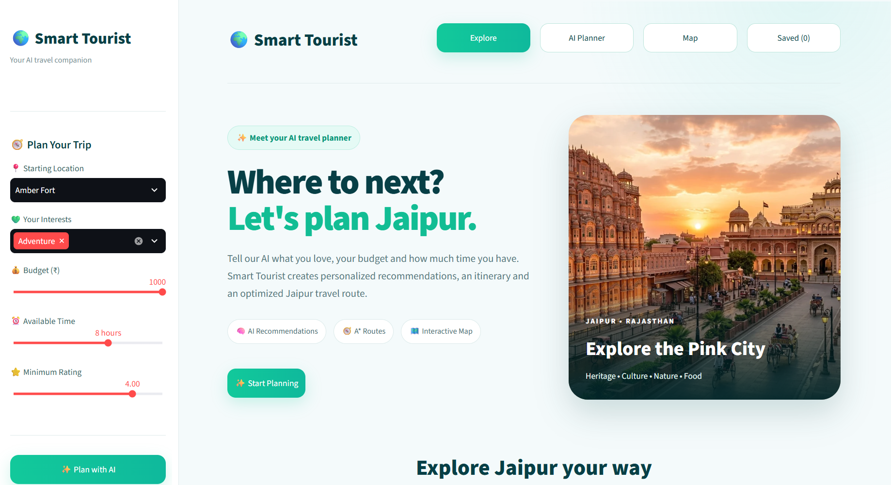
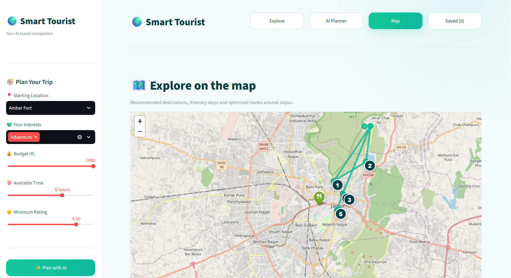
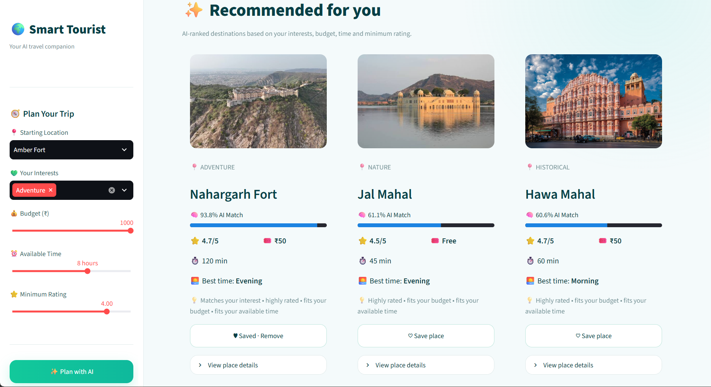
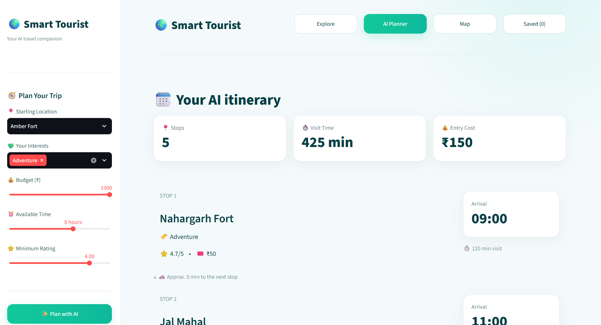
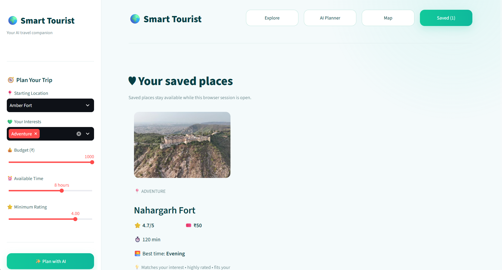

# Smart Tourist Guide

An AI-powered personalized travel planner for Jaipur, built with Streamlit. It recommends places to visit based on your interests, budget, and available time, plans a day itinerary, finds the shortest walking or driving route between attractions, suggests a restaurant, and shows everything on an interactive map.

## Features

- **Personalized recommendations.** Each place gets a 0 to 100 score based on four factors: interest match (40%), rating (25%), budget compatibility (20%), and time compatibility (15%). Places are filtered by a minimum rating.
- **Day itinerary planner.** Builds a schedule from the highest-scoring places that fit your time and budget, including 20 minutes of travel between stops.
- **Route finding.** Uses the A* search algorithm over a road network of distances between attractions, with straight-line (Haversine) distance as the heuristic.
- **Restaurant suggestion.** Recommends the highest-rated restaurant that fits your remaining budget after sightseeing costs.
- **Interactive map.** Shows places and routes on an OpenStreetMap-based map (Folium). Each place links to Google Maps.
- **Saved places.** Bookmark favourite attractions and view them in a Saved tab.

## Screenshots

**Home (Explore):** Plan your trip from the sidebar and browse the Jaipur highlights.



**AI recommendations:** Places ranked by AI match, with ratings, entry fees, visit times, and reasons for each suggestion.



**AI itinerary:** A timed day plan with arrival times, visit durations, and totals for stops, visit time, and entry cost.



**Interactive map:** Numbered itinerary stops, optimized routes, and a restaurant marker on OpenStreetMap.



**Saved places:** Bookmarked attractions for the current browser session.



## Tech Stack

- **Language:** Python 3
- **Web app:** Streamlit
- **Data:** pandas, NumPy
- **Maps:** Folium, streamlit-folium
- **Graphs:** NetworkX (listed in `requirements.txt`)
- **Charts:** Plotly

## Project Structure

```
Smart-Tourist-Guide/
├── app.py              # Streamlit UI: pages, sidebar inputs, map, and itinerary display
├── ai/
│   ├── recommender.py  # Scores and ranks places (interest, rating, budget, time)
│   ├── itinerary.py    # Builds a time- and budget-limited day plan
│   ├── pathfinding.py  # Graph building and A* route search
│   └── restaurant.py   # Rule-based restaurant recommendation
├── data/
│   ├── places.csv      # Attractions: rating, entry fee, visit duration, coordinates
│   ├── routes.csv      # Road connections between attractions with distances (km)
│   └── restaurants.csv # Restaurants: rating, average cost, coordinates
├── assets/             # Photos of attractions shown in the app
├── maps/               # Map package (currently empty; map code lives in app.py)
├── ui/                 # UI package (currently empty; UI code lives in app.py)
├── utils/              # Utility package (currently empty)
├── requirements.txt
└── .gitignore
```

## Getting Started

### Prerequisites

- Python 3.9 or newer
- pip

No API keys are needed. The map uses OpenStreetMap tiles.

### Installation

1. Clone the repository:

   ```bash
   git clone https://github.com/udaykumar417/Smart-Tourist-Guide.git
   cd Smart-Tourist-Guide
   ```

2. Create and activate a virtual environment (recommended):

   ```bash
   python -m venv venv
   source venv/bin/activate        # On Windows: venv\Scripts\activate
   ```

3. Install the dependencies:

   ```bash
   pip install -r requirements.txt
   ```

### Running the App

Run the app with Streamlit from the project root (the data files are read by relative path, so the working directory matters):

```bash
streamlit run app.py
```

Streamlit will print a local URL, usually `http://localhost:8501`. Open it in your browser.

## Using the App

The app has four pages:

- **Explore:** Browse recommended places, with photos and details.
- **AI Planner:** Set your starting location, interests, budget, available time, and minimum rating. The planner then creates an itinerary and a restaurant suggestion.
- **Map:** See the places and routes on an interactive map.
- **Saved:** View the places you have bookmarked.

## How It Works

1. **Input.** You choose a starting location, interest categories, budget (INR), available hours, and minimum rating.
2. **Scoring.** `ai/recommender.py` scores every place that meets the minimum rating and ranks them.
3. **Planning.** `ai/itinerary.py` walks down the ranked list and adds each place that fits your remaining time and budget, adding 20 minutes of travel time between stops.
4. **Routing.** `ai/pathfinding.py` builds a graph from `routes.csv` and runs A* to find the shortest path between two places.
5. **Dining.** `ai/restaurant.py` picks the highest-rated restaurant you can afford with the budget left after sightseeing.
6. **Display.** `app.py` shows the results and draws them on the map.

The recommendation and restaurant logic is rule-based. It does not use a trained machine learning model or an external AI service.

## Data

The bundled dataset is small and covers well-known Jaipur sites, such as Amber Fort, City Palace, Hawa Mahal, Jantar Mantar, Albert Hall Museum, Nahargarh Fort, and Jal Mahal. It includes:

- `places.csv`: 10 attractions
- `routes.csv`: 13 road connections with distances in km
- `restaurants.csv`: 4 restaurants

To add your own places, append rows to the matching CSV file, using the same column names. Make sure every name in `routes.csv` matches a name in `places.csv`, or the route search will not find it.

## Known Limitations

- The dataset is small, so recommendations and itineraries are limited to these 10 places.
- Travel time between stops is a fixed 20-minute estimate in the itinerary. It does not use the route distances.
- The `maps/`, `ui/`, and `utils/` folders are placeholders. Most of the code is in `app.py`.

## Contributing

1. Fork the repository.
2. Create a feature branch: `git checkout -b feature/your-feature`
3. Commit your changes: `git commit -m "Add your feature"`
4. Push the branch: `git push origin feature/your-feature`
5. Open a pull request.

## Author

**Uday Kumar** ([@udaykumar417](https://github.com/udaykumar417))
